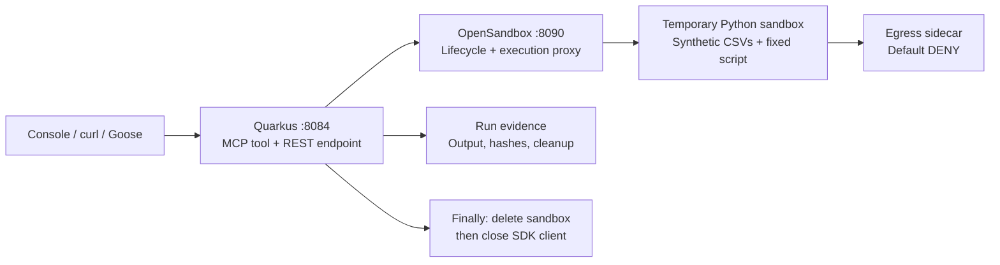

# Part 7: Governed Code Execution with Quarkus and OpenSandbox

[Tutorial home](index.md) · [Run the example](https://github.com/danieloh30/governed-agent-platform/tree/main/part7-opensandbox) · [Enterprise deep dives](../enterprise/index.md)

> **Lab contract:** You will execute a fixed Python script over synthetic CSVs in a real OpenSandbox. A Quarkus MCP tool selects from four predefined scenarios, requests resource limits and default-deny egress, records execution evidence, and attempts remote deletion on every path after creation. No LLM, provider credentials, GPU, or earlier services are required. The local control plane has a published demo API key; it is not a shared service or a production isolation assessment.

> **Enterprise context — Acme FinServ.** Sofia must explain a settlement discrepancy without giving an agent a shell on the payment service. The platform provides a narrow reconciliation operation: stage synthetic ledger and settlement files, run an approved script in a temporary environment, and return findings and lifecycle evidence. The operation cannot issue refunds or change production data.

## What This Adds to the Platform

Parts 1–6 govern tools, authorization, traces, workflows, regression evaluation,
and model traffic. Agent Skills in Part 4 describe the operational procedure;
this part governs the environment in which a procedure's code executes.

[OpenSandbox](https://open-sandbox.ai/getting-started/) supplies lifecycle and
execution APIs. We use its [Java SDK](https://open-sandbox.ai/sdks/kotlin) from
Quarkus, keeping the tool boundary and cleanup logic in Java. The Python file
is the workload executed inside the sandbox, not a client-side workflow engine.



The tool accepts only `reconcile`, `egress-check`, `timeout`, or `script-error`.
It accepts no shell command, image, host mount, URL, file path, or payment amount.
The REST console uses the same Java service as the MCP tool.

## Prerequisites

- Java 25+ and Maven 3.9+.
- A running local Docker engine, or Podman with its Docker-compatible API socket
  and bridge networking. On macOS, start the Podman machine first.
- Bash, Python 3.10+, and curl for the launcher, cleanup, and verification scripts.
- Network access to Maven Central and Docker Hub for the initial downloads.
- Optional: Goose with a configured model for the agent-client exercise.

Allow **35 minutes after dependencies and images are installed**. Part 7 runs
independently of Parts 1–6 and uses ports **8084** (Quarkus) and **8090**
(OpenSandbox). The engine allocates transient sandbox ports in **42000–43000**.

This lab pins the server and Java SDK to **1.2.0**, the execution agent image to
**v1.1.0**, the egress image to **v1.1.7**, and the workload to
**python:3.12.12-slim-bookworm**. These are release tags, not immutable image
digests. The component versions follow the server release's example config;
newer SDK features are not necessarily implemented by its execution image.

## Step 1: Start the Local Runtime

From the repository root:

```bash
cd part7-opensandbox
./sandbox.sh up
./start-all.sh
```

The first script selects Podman when available, otherwise Docker. Set
`CONTAINER_ENGINE=docker` or `CONTAINER_ENGINE=podman` explicitly when both are
installed. It pulls missing images and starts `governed-part7-opensandbox`.
It mounts the engine socket into that server so the server can manage workload
containers. Keep that control plane restricted to this local lab.

The server is containerized. Its egress readiness check needs a route to
host-published ports: the launcher supplies `host.docker.internal`, using the
actual Podman bridge gateway or Docker's `host-gateway` alias. With Podman it
also disables SELinux label separation for the **server container's socket
mount**; the workload does not receive the engine socket.

The lifecycle port is published on loopback. Transient execution and egress
ports are published on the engine host's interfaces so the containerized server
can probe them. Use a private development engine; do not expose that port range
on an untrusted network. A shared installation needs ingress and firewall policy
appropriate to its topology, independently of sandbox outbound policy.

Open [http://127.0.0.1:8084/](http://127.0.0.1:8084/). The console loads its policy
from Java and displays actual run responses. It does not simulate a successful
execution if OpenSandbox is unavailable.

## Step 2: Reconcile the Synthetic Data

Click **Run reconciliation**, or use:

```bash
curl --fail-with-body -sS http://127.0.0.1:8084/api/runs \
  -H 'Content-Type: application/json' \
  -d '{"scenario":"reconcile"}' | python3 -m json.tool
```

The CSV fixtures are packaged in `src/main/resources/workload/`. All amounts
are integer cents. Expected findings:

- `PAY-1002`: expected 8000 cents, settled 7500 — amount mismatch.
- `PAY-1004`: expected 6000 cents, absent from settlements — missing settlement.
- `PAY-1005`: absent from the ledger, settled 2000 — unexpected settlement.

The ledger total is **30000 cents**, the settlement total is **25500 cents**,
and the settlement-minus-ledger delta is **−4500 cents**. These fixture findings
do not establish anything about real customer payments.

The evidence response includes the run and sandbox IDs, execution ID, exit code,
stdout/stderr, workload SHA-256 hashes, elapsed time, lifecycle events, and
cleanup result. The console renders the discrepancies and lets you download
the full JSON response. Evidence is returned to the caller; this lab does not
provide a durable evidence store or a tamper-evident audit log.

## Step 3: Inspect the Java Boundary

`ReconciliationEndpoint.reconcileSettlements` is an MCP `@Tool`. Bean Validation
constrains its scenario argument; `ReconciliationService` also validates the
allowlist so the REST path has the same boundary. A semaphore permits one active
run per application instance. A competing REST request receives HTTP 409.

The SDK adapter creates a sandbox with:

```java
Sandbox sandbox = Sandbox.builder()
    .connectionConfig(connection)
    .image(image)
    .timeout(Duration.ofMinutes(3))
    .readyTimeout(Duration.ofSeconds(60))
    .resource(Map.of("cpu", "500m", "memory", "256Mi"))
    .metadata("tutorial", "governed-agent-platform-part7")
    .metadata("run-id", runId)
    .networkPolicy(NetworkPolicy.builder()
        .defaultAction(NetworkPolicy.DefaultAction.DENY).build())
    .build();
```

The connection uses the lifecycle server as an execution proxy, so the Java
client does not need to route to container-private addresses. Java reads the
three packaged files, hashes them, stages them through the SDK file API, and
executes the fixed command `python3 -I /tmp/reconcile.py <scenario>`. Every
command token is fixed or selected from the validated allowlist. No files or
commands come from a model, and no host workspace is mounted into the workload.

The command deadline is **15 seconds**, except the timeout exercise's
**2 seconds**. The sandbox's **180-second TTL** is a separate lifecycle backstop;
it is not the command timeout. The SDK transport and readiness waits have their
own limits, so end-to-end run duration includes more than command execution.

The orchestration attempts remote deletion in `finally`, then closes SDK client
resources. Closing the client alone does not delete the remote sandbox.
Cleanup failures turn the overall status into `FAILED`, even after a successful
script. The tests verify this behavior explicitly.

## Step 4: Verify Denied Egress and Failure Paths

Run the remaining console buttons, or change the `scenario` in the curl request:

- **`egress-check`** attempts TCP connections to `example.com:443` and
  `1.1.1.1:443`. Expect `COMPLETED`, `allBlocked: true` in stdout, and cleanup
  `DELETED`. The server config selects the upstream `dns+nft` enforcement mode;
  the application requests default-deny with no allow rules. A successful
  connection makes the script fail. Two failed probes can also result from an
  outage; they are an observed smoke check, not comprehensive isolation proof.
- **`timeout`** sleeps for 30 seconds under a 2-second command deadline. Expect
  `FAILED`, timeout/error evidence, and `DELETED`. Failed execution is the
  intended outcome; successful cleanup is checked independently.
- **`script-error`** exits with code 7. Expect `FAILED`, stderr describing the
  deliberate error, and `DELETED`.

Try an unapproved command:

```bash
curl -sS -i http://127.0.0.1:8084/api/runs \
  -H 'Content-Type: application/json' \
  -d '{"scenario":"reconcile; whoami"}'
```

Expect HTTP **400**, before any sandbox is created. Editing an Agent Skill to
request another command cannot change the server's scenario allowlist. This
operation has no approval workflow because it only handles fixed synthetic
inputs; Part 4's approval gate still governs its separate financial operations.

### Interpreting cleanup evidence

- `DELETED`: the server acknowledged remote deletion.
- `DELETE_FAILED`: the deletion request failed; inspect the returned sandbox ID
  and clean it up before stopping the lifecycle server.
- `CREATE_UNCONFIRMED`: creation was attempted but no usable handle was returned.
  A lost response can leave creation ambiguous. Inspect the lifecycle list for
  the response's `runId` metadata, then use the cleanup script.
- `NOT_CREATED`: failure occurred before attempting sandbox creation.

Do not infer successful deletion from client close, an empty output, a failed
HTTP request, or the TTL alone. The live smoke check additionally queries each
returned sandbox ID and requires HTTP 404 after deletion.

## Step 5: Connect Goose Through MCP

Add the project-local HTTP extension from `goose-extension-config.yaml` to your
Goose configuration using the same extension setup as Part 1. The endpoint is
`http://127.0.0.1:8084/mcp`; the tool is `reconcileSettlements`.

Ask Goose:

```text
Use reconcileSettlements with scenario reconcile to investigate Acme's
synthetic settlement discrepancy. Report the three findings in cents,
the sandbox ID, and the cleanup result. Do not infer that funds moved.
```

Goose submits the scenario through MCP. Quarkus handles provisioning, execution,
and cleanup. A model can choose an exposed scenario, but cannot supply arbitrary
code through this tool. An advanced extension could add reviewed code artifacts
with independent authorization and provenance; it is outside this lab.

## Step 6: Run the Checks and Clean Up

From the repository root:

```bash
# Unit and HTTP/MCP contract tests; no OpenSandbox runtime required
mvn -pl part7-opensandbox -am test

# With the runtime and Quarkus app still running:
python3 part7-opensandbox/smoke.py --evidence-dir /tmp/part7-evidence
```

The smoke check invokes reconciliation **through MCP**, the remaining scenarios
through REST, rejects an arbitrary command, verifies expected results, and
checks deletion through the real lifecycle API. A separate GitHub Actions job
runs this check with Docker; the normal Maven suite exercises failure and
cleanup logic without requiring an engine.

Stop the Quarkus app with **Ctrl+C**, then:

```bash
cd part7-opensandbox
./sandbox.sh down
```

The shutdown script first deletes workloads tagged for this tutorial through
the lifecycle API, then stops and removes its server container. It leaves other
containers and downloaded images alone. If lifecycle access fails, shutdown
stops before removing the server; inspect `./sandbox.sh logs` and recover access
instead of abandoning its TTL scheduler. Use `python3 cleanup.py` to retry only
the workload cleanup while the server is available.

## Production Boundaries

The runtime enforces the requested container CPU/memory limits and outbound
policy. The application bounds accepted work and concurrency; the server config
also requests a process limit and drops dangerous workload capabilities. These
controls do not turn a shared-kernel container into a VM boundary. Choose an
appropriate hardened runtime for untrusted generated code and validate it on
the actual deployment platform.

Before sharing this service, add authenticated tool callers, independent
authorization for lifecycle operations, private execution ingress, per-tenant
quotas, immutable image digests, durable evidence, and cleanup reconciliation.
The engine socket is a privileged control-plane capability; agents must not
receive it or the lifecycle API key. The public demo key only identifies the
local setup and is not an enterprise access-control mechanism.

## Further Reading

- [OpenSandbox quick start](https://open-sandbox.ai/getting-started/)
- [Java/Kotlin SDK](https://open-sandbox.ai/sdks/kotlin)
- [Pinned 1.2.0 server configuration](https://github.com/opensandbox-group/OpenSandbox/blob/release-1.2.0/server/opensandbox_server/examples/example.config.toml)
- [Network architecture and enforcement](https://github.com/opensandbox-group/OpenSandbox/tree/release-1.2.0/docs/architecture/network)
