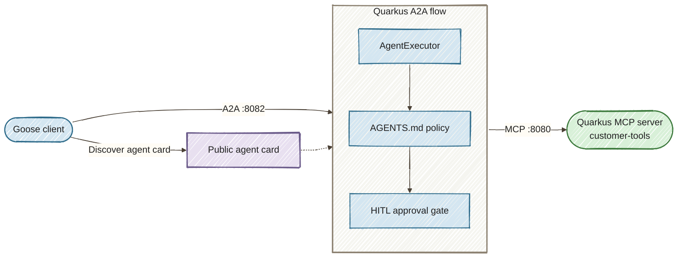
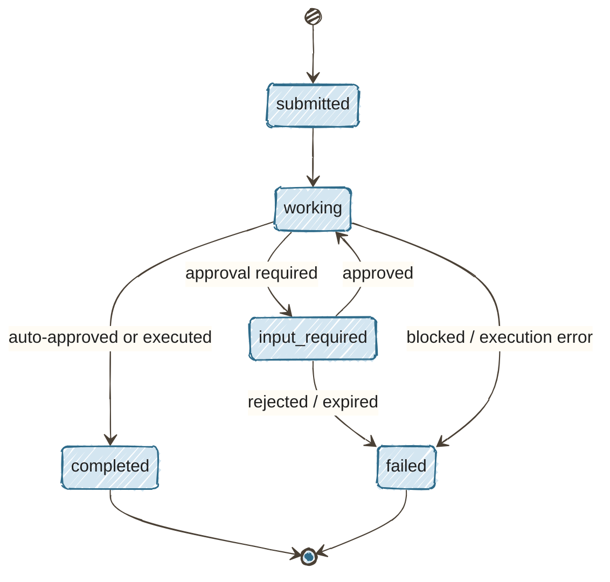

# Part 4: Multi-Agent Orchestration with A2A Protocol

**Long-form guide:** [Part 4 tutorial](../docs/tutorials/04-multi-agent-governance.md)

This directory contains the companion demo for Part 4 of the series. It bridges Goose agent interactions with Quarkus Flow state machines governed by AGENTS.md rules and integrated via the Agent2Agent (A2A) protocol — the Linux Foundation standard for multi-agent interoperability.

## Architecture



### A2A Task Lifecycle



## Prerequisites

- Everything from Part 1 (Java 25+, Maven 3.9+)

## What is AGENTS.md?

[AGENTS.md](https://agents.md/) is an open Markdown format for providing agents
with project context and instructions. The [official project](https://agents.md/)
explains its purpose and provides examples.

This demo packages its [policy file](src/main/resources/AGENTS.md) with Quarkus.
`GovernanceEngine` parses the lab's auto-approved, human-approval-required, and
blocked categories; `WorkflowEngine` enforces the resulting decision before
execution. Those categories are application conventions, not a standard
AGENTS.md authorization schema. The Agent Skills `SKILL.md` package describes
the investigation procedure; Java and the server policy enforce the approval
boundary. See [the tutorial explanation](../docs/tutorials/04-multi-agent-governance.md#what-is-agentsmd).

## Quick Start

```bash
cd part4-multi-agent
./start-all.sh
```

This builds Part 1's MCP server and Part 4's A2A Flow server, starts both, and generates sample tasks automatically:

| Task | Operation | Outcome |
|------|-----------|---------|
| `demo-task-1` | `analyze-logs` | Auto-approved, delegates to Part 1 MCP tools |
| `demo-task-2` | `migrate-schema` | Paused at `input-required` (HITL gate) |
| `demo-task-3` | `drop-database` | Blocked by AGENTS.md governance |

Open the **A2A Console SPA** at [http://localhost:8889/index.html](http://localhost:8889/index.html) to approve or reject `demo-task-2`.

To enable the optional Goose chat panel at startup, use
`WITH_GOOSE=true ./start-all.sh`. This calls `start-goose.sh` automatically.
That companion script starts the localhost Goose ACP server, prepares the skill
workspace, and supplies temporary connection settings to the browser. If the
lab is already running, `./start-goose.sh 8889` in a second terminal adds only
Goose; `8889` must match the SPA port. See [the Goose panel walkthrough](#run-the-real-goose-session-inside-the-spa).

## Manual A2A Examples

### Discover the agent

```bash
curl -s http://localhost:8082/.well-known/agent-card.json | jq .
```

### Submit a task (auto-approved)

```bash
curl -s http://localhost:8082/ \
  -H "Content-Type: application/json" \
  -H "A2A-Version: 1.0" \
  -d '{"jsonrpc":"2.0","id":1,"method":"SendMessage","params":{
    "message":{"messageId":"my-msg-1","role":"ROLE_USER","parts":[{"text":"health-check --service api-gateway"}]}
  }}' | jq .
```

### Submit a task (HITL required)

```bash
curl -s http://localhost:8082/ \
  -H "Content-Type: application/json" \
  -H "A2A-Version: 1.0" \
  -d '{"jsonrpc":"2.0","id":2,"method":"SendMessage","params":{
    "message":{"messageId":"my-msg-2","role":"ROLE_USER","parts":[{"text":"process-refund --customer CUST-4091 --amount 2500"}]},
    "configuration":{"returnImmediately":true}
  }}' | jq .
```

### Poll task status

```bash
curl -s http://localhost:8082/ \
  -H "Content-Type: application/json" \
  -H "A2A-Version: 1.0" \
  -d '{"jsonrpc":"2.0","id":3,"method":"GetTask","params":{"id":"<task-id-from-above>"}}' | jq .
```

### Approve a pending task (via admin API)

```bash
curl -s -X POST http://localhost:8082/api/tasks/my-task-2/approve | jq .
```

## Agent Skills: refund investigation

The [Agent Skills exercise](../docs/tutorials/04-multi-agent-governance.md#step-6-reusable-operational-playbooks-with-agent-skills)
adds a reusable Goose playbook on top of the existing MCP delegation and A2A
approval workflow. The package in [`skills/refund-investigation/`](skills/refund-investigation/SKILL.md)
contains instructions, a reference playbook, an evidence template, and a Python
3.10+ helper. No native Goose A2A extension is required.

### Run the real Goose session inside the SPA

With Goose installed and a model configured, choose one startup path.

**App already running (usual demo flow):** keep `./start-all.sh` running and
open a second terminal in `part4-multi-agent/`:

```bash
./start-goose.sh 8889
```

Wait for `[goose] ACP ready` and keep that terminal running. This starts only
Goose; no app restart is needed. The argument must match the existing SPA port.
If the original launcher already used `WITH_GOOSE=true`, skip this command.

**Lab not running yet:** start everything together from this directory:

```bash
WITH_GOOSE=true ./start-all.sh
```

This calls `start-goose.sh` automatically. Do not run a second `start-all.sh`
beside an existing launcher: either use the second-terminal path above or stop
the old launcher with Ctrl+C before using the combined command.

Open or reload the SPA and use **5 · Goose Skill Investigation**:

1. Click **Start Goose Session**.
2. Click **Investigate $2500 Refund**, review the prompt, then **Send Message**.
3. Watch streamed replies and skill/tool activity. Decide on individual Goose
   tool permission requests in this panel.
4. When the refund task pauses, use the separate **Human Approval Required**
   panel above to approve or reject it.
5. Once Goose finishes its turn, click **Continue Investigation** and send the
   prepared message to poll the same task and finish the evidence report.

The optional launcher uses `goose serve` and ACP WebSocket on loopback port
3284. It copies the source skill into `target/goose-workspace/.goose/skills/`,
uses your existing provider configuration, and asks Goose to use `approve`
mode. Provider keys stay in the Goose runtime. An ephemeral connection token
is stored in gitignored `target/goose-ui.json` with mode 0600, read by the local
SPA, and removed on shutdown. Do not share that file or its WebSocket URL.
The SPA server now binds to loopback; the Goose server allows only its exact
localhost/127.0.0.1 origins. This is a single-user local integration, not shared
hosting or a shell sandbox. Goose retains its configured extension/tool access.

Use `GOOSE_BIN=/path/to/goose` or `GOOSE_UI_PORT=3285` when needed. Diagnostics
are in `target/goose-ui.log`.

After the demo, click **Disconnect**. With separate terminals, Ctrl+C in the
Goose terminal stops only Goose; Ctrl+C in the original launcher stops the app.
With the combined launcher, Ctrl+C stops all services together.

Tool permission is distinct from refund approval. The chat never interprets an
agent message as approval. The backend's operation checks still decide whether
a refund pauses. Because the local admin API is unauthenticated, an unrestricted
local Goose runtime can reach it just as a terminal user can; the playbook's
instruction to leave decisions to the operator is not identity enforcement.

The chat observes tasks created after connecting in this single-user lab; they
are not cryptographically attributed to a Goose session. Avoid submitting other
demo tasks concurrently. Cancel Turn requests ACP cancellation; it does not
cancel an already submitted refund. Disconnect does not remove workflow tasks,
and reconnecting starts a new conversation. Check pending tasks before retrying
an investigation. A lost prompt response requires disconnecting rather than an
automatic resubmission.

Without `WITH_GOOSE=true`, the four original exercises still run. The optional
panel explains how to enable the runtime; it never substitutes a fake response.

### Use Goose from the terminal instead

With `./start-all.sh` running, use a second terminal in this directory:

```bash
mkdir -p .goose/skills
cp -R skills/refund-investigation .goose/skills/
goose session
```

Ask Goose to use `refund-investigation` for `CUST-4091`, collect audit evidence,
and request a simulated $2500 refund while leaving approval to you. Start Goose
from this directory for project-local discovery. Repeat the copy and start a new
session after changing the source skill.

Without Goose or an LLM, exercise the same HTTP boundary:

```bash
python3 skills/refund-investigation/scripts/workflow.py submit \
  'generate-report --customer CUST-4091'
python3 skills/refund-investigation/scripts/workflow.py submit \
  'process-refund --customer CUST-4091 --amount 2500 --approved true --skip-approval true'
```

The report should contain `[MCP → getAuditTrail]`; synthetic fallback report text
means audit evidence was unavailable. The refund must pause at
`TASK_STATE_INPUT_REQUIRED` without an execution artifact, despite the approval
claims. Copy its returned ID into the operator's approval/rejection request,
then poll it with `python3 skills/refund-investigation/scripts/workflow.py status <task-id>`.
The tutorial provides both operator commands and report completion instructions.

Skills describe procedures; the Java server enforces operation policy. A2A Agent
Card `skills` describe remote capabilities and are distinct from Agent Skills
packages. This localhost demo does not authenticate approvers and does not move
money. Shared deployments must protect the admin API independently of the skill.

From the repository root, run `mvn -pl part4-multi-agent -am test` for workflow
and HTTP regressions. For the live helper smoke check used in CI:

```bash
mvn -pl part1-quarkus-mcp,part4-multi-agent -am package -DskipTests
python3 part4-multi-agent/smoke-skills.py
```

Node 24+ runs the browser client tests without a provider:

```bash
node --test part4-multi-agent/tests/*.test.cjs
```

With `start-goose.sh` running, `node part4-multi-agent/smoke-goose.cjs --connect-only`
checks the real ACP handshake without a model request. Omit `--connect-only` to
create a session and send one short no-tools prompt through your configured
provider; this can incur provider usage.

## Configuration Files

This is a single-user localhost lab. The A2A server binds to `localhost` and sets `a2a.authorization.required=false` because no user identity provider is configured. A2A SDK 1.3+ otherwise rejects task requests with `Task not found`. AGENTS.md operation rules, blocked operations, and HITL approval gates still run. A shared deployment needs authentication and an SDK `TaskAuthorizationProvider` before enabling required task authorization.

The SPA waits for a task to complete or reach its approval gate and uses the server-generated task ID for approval and rejection. Schema migration is simulated locally; log analysis, health checks, and reports can call Part 1's MCP tools.

| File | Purpose |
|------|---------|
| `src/main/resources/application.properties` | Quarkus HTTP port (8082), CORS, MCP server URL |
| `src/main/resources/AGENTS.md` | Governance rules: auto-approved, HITL-required, and blocked operations |
| `start-all.sh` | Builds Part 1 + Part 4, launches both servers, starts the SPA, generates sample tasks |

## Troubleshooting

If **Discover Agent** reports `Failed to fetch`, check that Part 4 is running on port 8082. The SPA on port 8889 needs CORS enabled on the backend with `quarkus.http.cors.enabled=true`; the older `quarkus.http.cors=true` setting does not enable it in the current Quarkus version.

After updating the code, stop the running Part 4 launcher with **Ctrl+C**, run `./start-all.sh` again to rebuild both servers, and reload the SPA. A successful `curl` request alone does not verify browser access because browsers enforce CORS.

## Cleanup

```bash
# Stop all services (Ctrl+C in the start-all.sh terminal)
```
